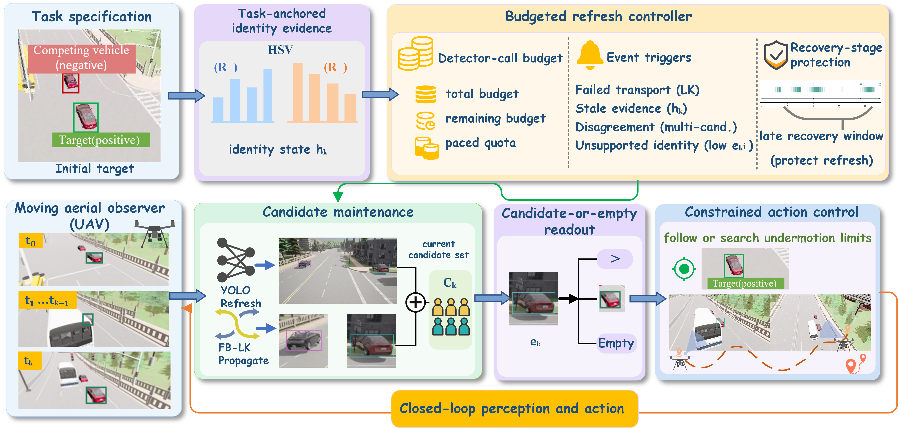
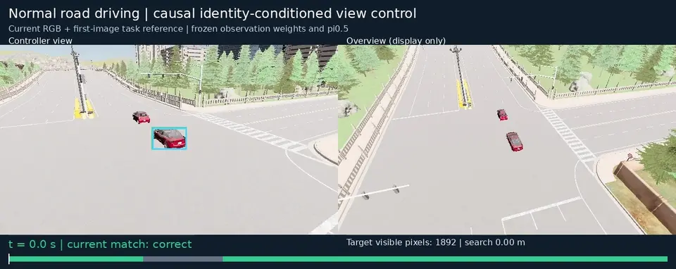
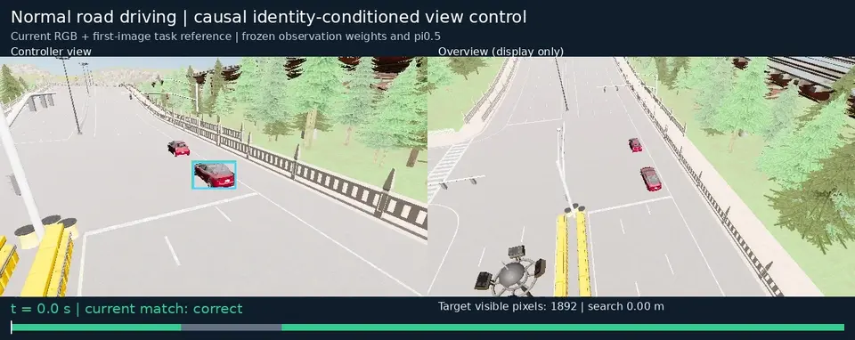
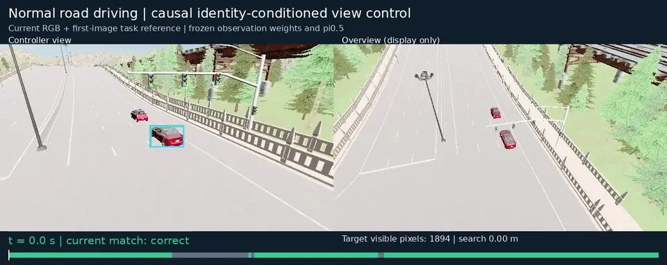

# RIVER

**Resource-Aware Identity Reacquisition for UAV Visual Tracking under Prolonged Occlusions**

RIVER follows a designated vehicle through long occlusions and recovers its identity when visually similar vehicles reappear. It builds a reference from the first task box, refreshes object detections when the current evidence warrants it, and propagates candidate masks between detector calls. The identity readout can withhold a match. The controller uses fresh identity evidence to point the camera and otherwise continues a bounded search.

[](docs/river-system-overview.png)

## Road-scene demos

### Reacquisition after bus occlusion (s164)

[](https://github.com/yuanbo6212/RIVER/releases/download/road-demos/road_bus_pass_s164.mp4)

[Download MP4](https://github.com/yuanbo6212/RIVER/releases/download/road-demos/road_bus_pass_s164.mp4)

### Reacquisition after bus occlusion (s239)

[](https://github.com/yuanbo6212/RIVER/releases/download/road-demos/road_bus_pass_s239.mp4)

[Download MP4](https://github.com/yuanbo6212/RIVER/releases/download/road-demos/road_bus_pass_s239.mp4)

### Reacquisition across two occlusions (s239)

[](https://github.com/yuanbo6212/RIVER/releases/download/road-demos/road_two_occlusions_s239.mp4)

[Download MP4](https://github.com/yuanbo6212/RIVER/releases/download/road-demos/road_two_occlusions_s239.mp4)

## Quick start

Use Python 3.10–3.12. The included example replays 18 recorded CARLA observations with their original candidate masks on CPU.

```bash
git clone https://github.com/yuanbo6212/RIVER.git
cd RIVER
python -m pip install -r requirements.txt
python scripts/replay_rgb.py --output replay.jsonl
```

Each JSONL row contains the source observation, the selected box or `null`, the readout scores, and the decision reason. The default replay checks the JPEG and candidate hashes and verifies the full-set readout against the archived values.

```bash
python scripts/replay_rgb.py --rule simple_margin --output margin.jsonl
python scripts/replay_rgb.py --rule no_empty --output forced-choice.jsonl
python scripts/summarize_results.py
```

### Run detection on RGB

Install the [Ultralytics YOLO11](https://docs.ultralytics.com/models/yolo11/) dependency and provide a YOLO11 segmentation checkpoint. The experiment configuration uses `yolo11l-seg.pt` with 640-pixel input, confidence threshold 0.25, NMS IoU 0.70, and the COCO car class.

```bash
python -m pip install -r requirements-detector.txt
python scripts/replay_rgb.py --weights weights/yolo11l-seg.pt --device cpu --output rgb.jsonl
```

For a custom sequence, use [`sequence.json`](examples/carla/sequence.json) as the input format. Supply `initial_box` as `[x0, y0, x1, y1]` and one row per observation with the JPEG path, image dimensions, capture times, camera pose `[x, y, z, pitch, yaw, roll]` in meters and degrees, and a row-major intrinsic matrix. Choose `--sequence path/to/sequence.json` to load it. Provide observations 0–229 and pass `--refresh independent128`, `--refresh uniform128`, or `--refresh full230` to exercise the original refresh and mask transport policies.

## CARLA results

The moving comparison uses 19 complete spatial groups and 76 paired tasks per arm. The recovery window spans observations 185–229, and last-10 retention requires correct identity at each of observations 220–229.

| Refresh policy | Correct recovery frames | Last-10 retention | Detector calls | Module time |
| --- | ---: | ---: | ---: | ---: |
| Full-230 | 1792 / 3420 | 32 / 76 | 17,480 | 544.574 s |
| Uniform-128 | 1755 / 3420 | 38 / 76 | 9,728 | 414.178 s |
| **Independent-128** | **1901 / 3420** | **44 / 76** | **9,198** | **409.940 s** |

Independent-128 reduces detector calls by **47.38%** and module processing time by **24.72%** compared with Full-230, while improving correct recovery by **3.19 percentage points**.

The rejection comparison gives all three arms the same 128 detector calls per task. The full-set and margin readouts recover 1844 and 1845 correct frames out of 3600, respectively, with zero sustained identity errors. Forced choice recovers 1528 correct frames and produces sustained identity errors in 19 of 80 tasks. The initialization comparison changes only the initial search direction. Over 16 complete groups, default, fixed-left, and fixed-right initialization retain the target in 92, 101, and 84 of 128 tasks, respectively. [Generated tables](data/RESULTS.md)

## Repository layout

| Path | Contents |
| --- | --- |
| [`src/river_mobile_quality_v1_20261116.py`](src/river_mobile_quality_v1_20261116.py) | Full, uniform, and evidence-driven detector refresh with mask transport |
| [`src/rejection_readout_v1.py`](src/rejection_readout_v1.py) | Full-set, forced-choice, and margin identity readouts |
| [`src/river_e03_perception.py`](src/river_e03_perception.py) and [`src/bounded_frame_worker_v1.py`](src/bounded_frame_worker_v1.py) | Source-bound perception and asynchronous frame delivery |
| [`src/river_e03_feedback_v2.py`](src/river_e03_feedback_v2.py) and [`src/river_e03_shared_actions_v2.py`](src/river_e03_shared_actions_v2.py) | Freshness-aware motion policy and constrained action execution |
| [`src/initialization_ablation_control_v1.py`](src/initialization_ablation_control_v1.py) | Three initial directions with a common later control policy |
| [`artifacts/`](artifacts/) | Fitted readout parameters and action regression trace |
| [`examples/carla/`](examples/carla/) | RGB images, candidate masks, and reference input for replay |
| [`data/`](data/) | Assignment records and per-task outcomes for the three studies |

```bash
python -m pip install pytest
python -m pytest -q
```
